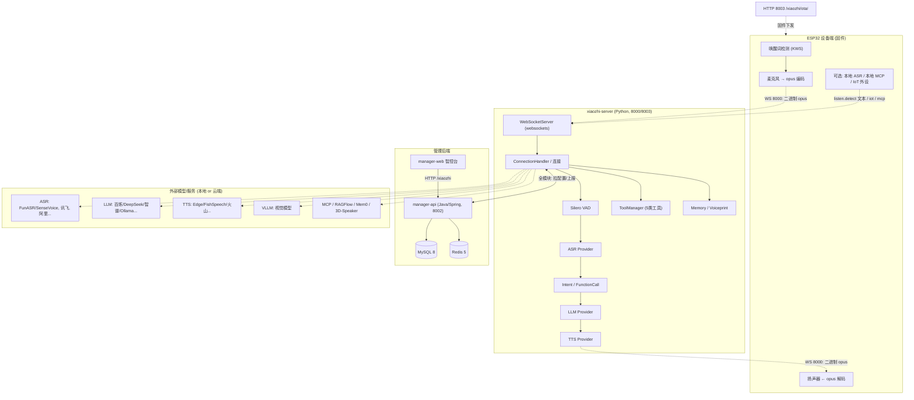
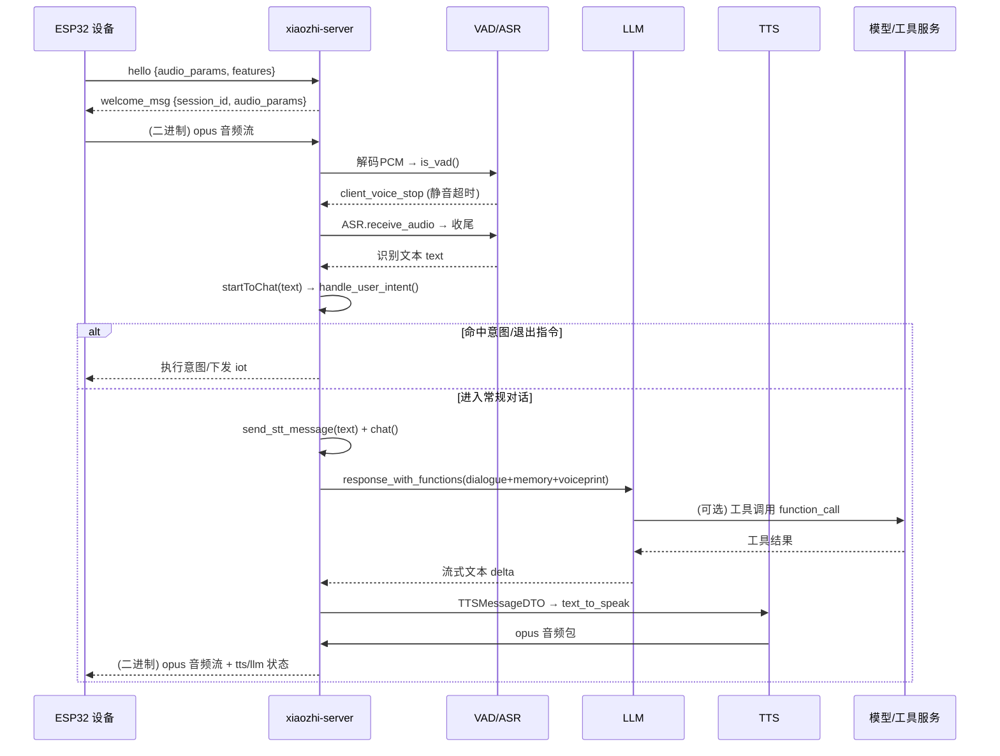

# 小智后端 xiaozhi-esp32-server · 架构深度分析

> 文档定位：面向**开发者 / 部署运维**的架构总览。覆盖「怎么唤醒、怎么对话、怎么通信、用了哪些模型」，并补充「容易忽略但重要的设计点」。
> 代码基线：`main/xiaozhi-server`（Python 核心）、`main/manager-api`（Java）、`main/manager-web`（Vue 智控台）、`main/digital-human`（数字人）。
> 主要参考源码（均已逐行核实）：`app.py`、`core/connection.py`、`core/websocket_server.py`、`core/connection…handle/*`、`core/providers/*`、`config/config_loader.py`。

---

## 0. 一句话结论

小智后端是一个**分层、可插拔的语音 Agent 服务**：ESP32 设备端负责**唤醒词检测 +（可选）本地 ASR**，通过 **WebSocket（8000）** 以「二进制 opus 音频 + 带 `type` 的 JSON 控制消息」与服务端通信；服务端 `xiaozhi-server`（Python）**每连接一个 `ConnectionHandler` 实例**，跑通 **Silero VAD 端点检测 → ASR → 意图/函数调用路由 → LLM → TTS → opus 回传**；所有 AI 能力（ASR/LLM/TTS/VLLM/Intent/Memory/Voiceprint/Rag）都以 **Provider 抽象**接入，本地可跑、云端可接；整体可由 `manager-api`（Java 后端）做多设备/多智能体的集中配置、鉴权与持久化，再由 `manager-web` 提供可视化智控台。

---

## 1. 项目定位与三大模块（+数字人）

| 模块 | 语言/框架 | 端口 | 职责 |
|---|---|---|---|
| **xiaozhi-server** | Python 3.10（asyncio + `websockets` + `aiohttp`） | WS `8000` / HTTP `8003` | 对话核心引擎：连接管理、音频流水线、Provider 编排、工具/MCP、OTA、视觉分析 |
| **manager-api** | Java 21 / Spring Boot | `8002`（context-path `/xiaozhi`） | 多用户/多智能体管理后端：设备、用户、智能体、模型配置、记忆上报；用 **Liquibase** 自动建表（MySQL 8 + Redis 5） |
| **manager-web** | Vue 2（Vue CLI） | 编译后静态资源，经 Nginx/后端托管 | 智控台 UI：用户/系统/设备管理、`agent models` 模型配置、服务端配置 |
| **digital-human** | Python + 前端 | `8006` | 数字人测试页 + 本地唤醒词运行时（`wakeword_runtime`）+ 事件桥（`ws://127.0.0.1:8006/wakeword-ws`），用于联调整机链路 |

> 入口：`app.py` 同时拉起 `WebSocketServer(8000)` 与 `SimpleHttpServer(8003)`（`core/http_server.py`，`aiohttp`）。

### 两种部署模式（决定了配置来源）

| 模式 | 特点 | 配置来源 | 数据持久化 |
|---|---|---|---|
| **最简化（only server）** | 单智能体、对话即可 | 本地 `data/.config.yaml` | 无数据库 |
| **全模块（server + manager-api + manager-web）** | 多用户/多智能体、智控台 | `data/.config.yaml` 仅配 `manager-api.url/secret`，其余全部由 `manager-api` 下发 | MySQL / Redis |

> ⚠️ **全模块模式下的关键认知（极易踩坑）**：一旦 `data/.config.yaml` 里出现 `manager-api.url`，`config_loader.load_config()` 就走 `get_config_from_api_async()`，**直接忽略 `config.yaml` 与 `data/.config.yaml` 里的 ASR/LLM/TTS/Intent/插件等配置**，改从 `manager-api` 拉取（见 §9）。模型密钥在智控台「模型配置 / agent models」里配，不在任何 yaml 文件里。

---

## 2. 系统总体架构图



---

## 3. 唤醒机制（「怎么唤醒」—— 先澄清一个最大误区）

### 3.1 核心结论：唤醒词在**设备端**，不在服务端

- 小智固件在 **ESP32 侧**做关键词 spotting（KWS）。设备检测到唤醒词后，才进入「聆听」状态并开始向服务端传音频（或上报本地 ASR 文本）。
- 服务端**不运行唤醒检测模型**。它在 `core/utils/wakeup_word.py` 里做的只是**「唤醒词应答缓存」**：把唤醒后的固定问候语 TTS 音频按 voice 的 md5 缓存到 `data/.wakeup_words.yaml`，唤醒瞬间直接播放，省去一次 TTS 合成延迟。

### 3.2 服务端真正做的「端点检测」= Silero VAD

当用户开始说话后，服务端用 **Silero VAD**（本地 ONNX 模型）在收到的 PCM 流上做语音活动检测（`core/providers/vad/silero.py`）：双阈值（0.5/0.2）+ 滑窗，静音超过 `min_silence_duration_ms`（默认 1000ms）即判定「用户说完一句话」→ 触发 ASR 收尾与对话。

### 3.3 唤醒应答与回声防护

- `core/handle/helloHandle.py::checkWakeupWords()`：把识别文本与 `conn.config["wakeup_words"]` 比对，命中则 `conn.just_woken_up = True` 并播放缓存问候语。
- **唤醒后抑制 VAD 2 秒**（`resume_vad_detection`，`helloHandle.py:37`）：避免服务端把自己刚播放的问候语回声又当成用户说话——这是实时语音系统常见的回声陷阱，本项目用「临时关 VAD」而非 AEC 来兜底。

### 3.4 两种「聆听」工作模式

| 模式 | 设备发什么 | 服务端做什么 |
|---|---|---|
| **设备本地 ASR** | `listen` 消息 `state=detect` + 已识别文本（可能带 `[device_call]` 来电标记） | 跳过 VAD/ASR，直接进意图/LLM |
| **设备发原始 opus** | 二进制 opus 音频流 | 服务端解码 → Silero VAD 端点检测 → 服务端 ASR |

`listen` 消息的 `state` 取值：`start`（清空音频缓冲）、`stop`（触发 ASR 收尾）、`detect`（本地已识别，直接报文本）。

---

## 4. 对话流程（「怎么对话」—— 端到端流水线）

主管理器：`core/connection.py` → `class ConnectionHandler`（每个 WebSocket 连接一个实例）。**没有显式状态枚举**，状态由若干标志位隐式表达：

```
client_listen_mode ∈ {auto, manual}
client_is_speaking / client_abort / client_have_voice / client_voice_stop
just_woken_up / calling / incoming_call / need_bind / close_after_chat
```

### 4.1 完整链路（audio → text → LLM → text → audio）



### 4.2 八步拆解

1. **接收**：`ConnectionHandler._route_message`（`connection.py:348`）——文本走 `handleTextMessage`，二进制 opus 用 `opuslib_next.Decoder(16000,1)` 解码后入 `asr_audio_queue`。
2. **VAD + 接收**：`handleAudioMessage`（`receiveAudioHandle.py:17`）→ `conn.vad.is_vad()`；若设备刚唤醒则压 2 秒 VAD；若开启服务端 AEC 且检测到人声 → 立即 `handleAbortMessage` 打断。
3. **语音停止**：VAD 置位后 `ASRProviderBase.handle_voice_stop` **并发**跑 ASR 与声纹识别（`asyncio.gather`），得到文本后进入 `startToChat`。
4. **意图前置**：`handle_user_intent` —— 先查退出指令、再查唤醒词，再按 `intent_type` 决定：`function_call` 直接放行进 LLM；`intent_llm`/`nointent` 先用小模型判定。
5. **LLM**：`ConnectionHandler.chat`（`connection.py:1055`）——
   - 查询记忆 `memory.query_memory`
   - `llm.response(...)` 或 `response_with_functions(...)`（流式）
   - 每个文本片段包成 `TTSMessageDTO` 推入 `tts.tts_text_queue`
   - 工具调用：收集 `tool_calls_list`，合并 `DIRECT_ANSWER_TOOL` 虚拟工具，调 `func_handler.handle_llm_function_call`
6. **TTS 合成**：`TTSProviderBase.tts_text_priority_thread` 分段 → `to_tts_stream` → 各 provider `text_to_speak` → `OpusEncoderUtils` 编码（60ms/帧）→ 入 `tts_audio_queue`。
7. **音频发送**：`_audio_play_priority_thread` → `sendAudioMessage`（`sendAudioHandle.py:21`）→ opus 包经 WS 发出（含 `AudioRateController` 流量整形、5 包预缓冲）。
8. **结束**：`tts` 状态 `stop` 后清 `client_is_speaking`；若 `close_after_chat` 则关连接；静音超 `close_connection_no_voice_time`（默认 120s）自动播告别语并关连接。

### 4.3 打断（Barge-in）

- **客户端打断**：设备发 `abort` 消息 → `handleAbortMessage` 置 `client_abort`，正在发送的音频循环抛 `CancelledError` 中止。
- **服务端 AEC 打断**：当 `hello.features.aec=true` 且服务端在播放时检测到人声 → 主动 `handleAbortMessage`（实时打断，无需等设备发 abort）。

### 4.4 工具/函数调用循环

- `intent_type=="function_call"` 时，`chat()` 向 LLM 注入 `functions`（工具清单）+ `DIRECT_ANSWER_TOOL`（把「是否调用工具」变成「调用哪个工具」，防止小模型误触发真实工具）。
- **`MAX_DEPTH=5`**：工具调用递归上限，超过则强制 LLM 基于已有信息直接作答（防无限循环）。
- 流式抽取 `direct_answer` 的 `response` 参数**实时送 TTS**，让用户尽快听到声音。

---

## 5. 通信协议（「怎么通信」—— WebSocket + HTTP）

### 5.1 传输层

| 端口 | 库 | 用途 |
|---|---|---|
| `8000` (WS) | `websockets`（`core/websocket_server.py:4,76`） | 主对话通道：二进制 opus 音频 + JSON 控制消息 |
| `8003` (HTTP) | `aiohttp`（`core/http_server.py`） | `/xiaozhi/ota/`（OTA 固件）、`/mcp/vision/explain`（视觉分析） |

### 5.2 帧格式

- **二进制帧 = opus 音频**（双向，设备→服务端 16k 解码、服务端→设备由 `welcome_msg.audio_params.sample_rate` 决定，默认 24k）。
- **JSON 文本帧**带 `type` 字段。上行类型枚举（`core/handle/textMessageType.py`）：

| type | 方向 | 含义 |
|---|---|---|
| `hello` | 设备→服务端 | 上报 `audio_params`、`features`(mcp/aec/emoji)、`session_id` |
| `listen` | 设备→服务端 | `state`: start/stop/detect；`text`(detect 时) |
| `abort` | 设备→服务端 | 打断/停止当前播报 |
| `iot` | 设备→服务端 | 设备外设描述符 `descriptors`/状态 `states` |
| `mcp` | 设备↔服务端 | 设备作为 MCP Server 的 JSON-RPC 封装 |
| `server` | 设备↔服务端 | 服务端控制指令（如重启 `restart`） |
| `ping`/`pong` | 双向 | 心跳保活 |

- **服务端下行**的关键 JSON（注意：这些是**代码里实际下发**的类型，仓库无独立 PROTOCOL.md）：
  - `stt`：`{"type":"stt","text":...,"session_id":...}`（把识别/展示文本回显给设备 UI）
  - `tts`：`{"type":"tts","state":"sentence_start"|"start"|"stop","session_id":...}`（控制设备播放状态机）
  - `llm`：`{"type":"llm","text":emoji,"emotion":...}`（表情/情绪，受 `features.emoji` 开关控制）
  - `iot`：`{"type":"iot","commands":[...]}`（向设备下发控制指令）
  - `hello` 应答：`conn.welcome_msg = config["xiaozhi"]`（含 `audio_params`/采样率/`session_id`）

### 5.3 握手与鉴权

- `hello` 握手：服务端把 `session_id` 写入 `welcome_msg` 回发（`helloHandle.py:61`）。
- 鉴权（`core/auth.py` `AuthManager`，**HMAC-SHA256**）：
  - 设备头：`Device-ID` / `Client-ID` / `Authorization: Bearer <token>`；MQTT 走 `client_id/username/password`（`ota_handler.generate_password_signature`）。
  - `server.auth.enabled=true` 时校验；`allowed_devices` 白名单可免 token。
  - `auth_key` 优先级（`app.py:50`）：`server.auth_key` → `manager-api.secret` → 随机 uuid。

### 5.4 MQTT 网关模式（特殊通道）

连接 URL 带 `?from=mqtt_gateway`（`connection.py:228`）时，音频包前加 **16 字节头**（type/长度/seq/时间戳，`sendAudioHandle.py:84`），用于经 MQTT 中转的弱网/跨网场景，并支持服务端 AEC 回声消除。

---

## 6. 用到的模型与 Provider（「用了哪些模型」）

所有能力经 `core/utils/{asr,tts,llm,memory,vllm,intent}.py` 的工厂 + `core/utils/modules_initialize.py` 初始化，统一抽象为 Provider。**本地 = 服务进程内运行；云端 = 调外部 API。**

| 能力 | Provider 实现（文件） | 典型具体模型/服务 | 本地/云端 |
|---|---|---|---|
| **VAD** | `vad/silero.py` | Silero VAD（onnx） | **本地** |
| **ASR** | `asr/fun_local.py` | FunASR / **SenseVoiceSmall**（默认 `models/SenseVoiceSmall/model.pt`） | **本地** |
| | `asr/sherpa_onnx_local.py` | sherpa-onnx (paraformer/sense_voice) | **本地** |
| | `asr/vosk.py` | Vosk | **本地** |
| | `asr/fun_server.py` | FunASR 服务 | 本地服务 |
| | `asr/doubao*.py` `tencent.py` `aliyun*_stream.py` `baidu.py` `openai.py` `qwen3_asr_flash.py` `xunfei_stream.py` | 字节/腾讯/阿里/百度/OpenAI/千问/讯飞 | 云端 |
| **LLM** | `llm/openai/openai.py` | OpenAI 兼容（百炼/DeepSeek/智谱/Gemini…）+ `response_with_functions` | 云端/自建 |
| | `llm/AliBL` `coze` `dify` `fastgpt` `gemini` `homeassistant` | 各平台 API | 云端 |
| | `llm/ollama` `llm/xinference` | Ollama / Xinference | **可本地** |
| **TTS** | `tts/fishspeech.py` `gpt_sovits_v2/v3.py` `index_stream.py` `paddle_speech.py` | FishSpeech / GPT-SoVITS / Index-TTS / PaddleSpeech | **本地** |
| | `tts/edge.py` `doubao.py` `huoshan_double_stream.py` `aliyun*.py` `tencent.py` `openai.py` `cozecn.py` `xunfei_stream.py` `siliconflow.py` `custom.py` | Edge / 火山流式 / 阿里 / 腾讯 / OpenAI / Coze / 讯飞 / SiliconFlow | 云端 |
| **VLLM** | `vllm/openai.py` | OpenAI 兼容视觉模型（看图说话，`/mcp/vision/explain`） | 云端/自建 |
| **Intent** | `intent/nointent` `intent/intent_llm` `intent/function_call` | 无意图 / 小模型判定 / LLM 函数调用 | 视所用 LLM |
| **Memory** | `memory/nomem` `mem_local_short`(本地 YAML 短期记忆) `mem_report_only` `mem0ai` `powermem` | 不记忆 / 本地 / Mem0 / PowerMemory(OceanBase) | 本地为主 |
| **Voiceprint** | `core/utils/voiceprint_provider.py` | 3D-Speaker 风格外部服务 | 外部服务 |
| **Rag** | `rag/ragflow` | RAGFlow 检索增强 | 云端 |

### 6.1 官方推荐的两套组合

| 模块 | 入门全免费 | 流式（低延迟） |
|---|---|---|
| ASR | FunASR（本地） | 讯飞流式 |
| LLM | glm-4-flash（智谱） | qwen-flash（阿里百炼） |
| VLLM | glm-4v-flash（智谱） | qwen3.5-flash（阿里百炼） |
| TTS | EdgeTTS | 火山流式双工 |
| Intent | function_call | function_call |
| Memory | mem_local_short | mem_local_short |

### 6.2 关键本地模型资源

- `models/SenseVoiceSmall/model.pt`：默认离线 ASR（几百 MB，需手动下载）。
- `silero_vad.onnx`：VAD 模型。
- 声纹：`voiceprint` 走外部 3D-Speaker 服务（非内嵌）。
- 本地 TTS：FishSpeech / GPT-SoVITS / Index-TTS 需各自模型权重。
- 系统依赖（非 pip）：`ffmpeg`、`libopus`、`libiconv`。

---

## 7. 工具 / MCP / IoT 能力（统一工具层）

统一抽象在 `core/providers/tools/`，由 `UnifiedToolHandler` + `ToolManager` 按 `ToolType` 路由：

| ToolType | 来源 | 说明 |
|---|---|---|
| **SERVER_PLUGIN** | `plugins_func/functions/` | 服务端 Python 函数（`get_weather`/`play_music`/`web_search`/`get_news_*`/`search_from_ragflow`/`hass_*`/`change_role`/`call_device`…），`@register_function` 注册 |
| **SERVER_MCP** | `data/.mcp_server_settings.json` | 服务端启动多个 MCP Server（`ServerMCPManager`，带重连重试） |
| **DEVICE_IOT** | 设备 `iot` 消息 | 设备外设描述符动态注册成 `get_<device>_<prop>` / `<device>_<method>` 工具，控制命令回发 `{"type":"iot","commands":[...]}` |
| **DEVICE_MCP** | 设备作为 MCP Server | 服务端是 Client，`initialize`→`tools/list`→`tools/call` 走 JSON-RPC 封装在 `type:"mcp"` |
| **MCP_ENDPOINT** | 外部 MCP 接入点 | `app.py` 把 `mcp_endpoint` 的 `/mcp/` 换成 `/call/`（websocket） |

> 插件注册表：`plugins_func/register.py` 的 `all_function_registry` / `module_func_map`；`Action` 枚举：`RESPONSE/REQLLM/RECORD/NOTFOUND/ERROR/NONE`。

---

## 8. 配置与多设备管理体系（最易踩坑处）

`config/config_loader.py` 三种加载路径：

1. **merge 模式**（无 `manager-api.url`）：`config.yaml`（默认）+ `data/.config.yaml`（用户）递归合并，用户配置优先。
2. **全模块模式** `get_config_from_api_async()`（有 `manager-api.url`）：**全局配置从 `manager-api` 拉取**，`server` 块（ip/port/http_port/vision_explain/auth_key）始终以本地 `data/.config.yaml` 为准（`config_loader.py:71-80`），`prompt_template` 缺失时回退本地。
3. **设备私有配置** `get_private_config_from_api(device_id, client_id)`：按设备拉取 `agent models`（覆盖 ASR/LLM/TTS/VLLM/Memory/Intent/声纹/插件/`mcp_endpoint`）与 `correct_words`——**实现「同一后端、不同设备用不同模型」**。

> 记忆点：全模块下改 `config.yaml` / `data/.config.yaml` 里的模型配置**无效**，必须在智控台改；只有 `server{}`、`manager-api{}`、`prompt_template` 以本地为准。

---

## 9. 你「没想到但很重要」的设计点（深度补充）

1. **声纹识别与身份注入**：`voiceprint_provider.py` + `dialogue.py` 把说话人写入系统提示 `<speakers_info>`，且**仅在该说话人首次出现时注入**，避免模型每轮重复称呼（解决「小智能一直叫你名字」的经典 bug）。
2. **表情 / 情绪 emoji 下发**：`core/utils/textUtils.py` 从文本取首个 emoji（20 个映射），下发 `{"type":"llm","text":emoji,"emotion":...}`，驱动设备表情屏；受 `features.emoji` 开关控制。
3. **记忆系统**：`mem_local_short` 用专用 LLM 把对话压缩成「时空记忆」JSON 存本地 `data/.memory.yaml`；`chat()` 时 `query_memory` 结果注入 `<memory>` 占位符。记忆保存在连接关闭时的守护线程里（`_save_and_close`）。
4. **流量整形（AudioRateController）**：TTS 回传不是无脑猛发——60ms/帧，前 5 包预缓冲直接发、其余按 `interval_ms` 节奏发，防止设备端播放卡顿/爆缓冲（`sendAudioHandle.py`，`PRE_BUFFER_COUNT=5`）。
5. **服务端 AEC 回声消除**：`connection.py:_apply_aec`（互相关 + Wiener + 谱减），仅当 `hello.features.aec=true` 开启，用于外放喇叭场景的实时打断。
6. **设备绑定**：首次连接若需绑定，播放 6 位 `bind_code` 数字音频，提示用户去智控台输入绑定（`receiveAudioHandle.check_bind_device`）。
7. **OTA 固件下发与版本比对**：`/xiaozhi/ota/` 从 `data/bin/{model}_{version}.bin` 比版本，下发下载 URL + WS/MQTT 连接信息。
8. **视觉分析接口**：`/mcp/vision/explain`（HTTP 8003）接收图片 + 问题，调 VLLM 做「看图说话」，扩展了纯语音之外的多模态能力。
9. **多设备隔离**：每 WS 连接独立 `ConnectionHandler`（独立 VAD 状态、ASR/TTS 实例、Dialogue、声纹）；本地 ASR 多连接可共享单实例降本。
10. **MQTT 网关模式**：`?from=mqtt_gateway` + 16 字节帧头，支持跨网/弱网中转与服务端 AEC。
11. **对话自动结束**：静音超 `close_connection_no_voice_time`（默认 120s）自动播告别语（`"时间过得真快…"`）并关连接；另有**输出字数上限**保护（`max_output_size`）。
12. **来电 / 呼叫模式**：`listen.detect` 文本以 `[device_call]` 开头进入 `incoming_call`，可模拟电话接听（`device-call-guide.md`）。
13. **数字人 / 一体机**：`digital-human` 提供本地测试页（`index.html`，8006）+ 唤醒词运行时（`wakeword_runtime`）+ 事件桥，配合 `all-in-one-digital-human-setup.md` 可做 Kiosk 整机落地——这是「设备上没有小智固件也能对话」的另一种入口。
14. **安全性警告（来自官方 README）**：项目**未通过网络安全测评**，**请勿在生产环境直接暴露公网**；所有第三方 API 密钥由用户自己承担风险，软件不托管密钥、不参与资金流。

---

## 10. 关键文件索引

| 关注点 | 文件 |
|---|---|
| 启动入口 / 端口 / auth_key 优先级 | `main/xiaozhi-server/app.py` |
| WS 服务 / 鉴权 / 模块预初始化 | `core/websocket_server.py` |
| 连接管理 / 状态标志位 / chat() 流水线 | `core/connection.py` |
| 消息类型枚举 | `core/handle/textMessageType.py` |
| hello 握手 / 唤醒应答缓存 / VAD 抑制 | `core/handle/helloHandle.py` |
| 音频接收 / VAD+ASR / 意图前置 / 超时结束 | `core/handle/receiveAudioHandle.py` |
| opus 发送 / TTS 状态 / 流量整形 / MQTT 帧头 | `core/handle/sendAudioHandle.py` |
| Provider 抽象（ASR/LLM/TTS/VLLM/Memory/Intent/VAD） | `core/providers/*` |
| 工具 / MCP / IoT 统一路由 | `core/providers/tools/` + `plugins_func/` |
| 配置加载（merge / API / 设备私有） | `config/config_loader.py` |
| HTTP: OTA + 视觉分析 | `core/http_server.py` + `core/api/` |
| 管理后端 | `main/manager-api/`（Spring Boot，8002，`/xiaozhi`，Liquibase 建表） |
| 智控台前端 | `main/manager-web/`（Vue 2 CLI） |
| 数字人测试 / 一体机 | `main/digital-human/` |

---

## 11. 部署与运维速记

- **最简 vs 全模块**：仅供参考见 `docs/Deployment.md` / `docs/Deployment_all.md`；源码 uv 启服见 `start.md`。
- **资源**：FunASR 本地约 2C4G；全 API 约 2C2G；全模块 + FunASR 约 4C8G。
- **常见坑**：
  - 全模块改 `config.yaml` 无效（见 §8）。
  - `manager-api.secret` 必须与智控台 `server.secret` **完全一致**，否则连不上。
  - `opus.dll` / `libopus` / `ffmpeg` / `libiconv` 是系统原生依赖，pip 装不到，需单独装。
  - `'ascii' codec can't encode` 报错通常是某处 `api_key` 仍是占位符 `你的api_key`。
  - 官方预构建镜像仅 x86_64；ARM 需按 `docs/docker-build.md` 自编译。

---

> 本文档由对源码的逐文件核实整理而成，重点澄清了「唤醒在设备端、VAD 在服务端」「全模块配置来自 API 而非 yaml」「状态机是隐式标志位」三件最容易误解的事。后续若需针对某一模块（如 MCP 接入、声纹、OTA）深挖，可单独扩展对应小节。
